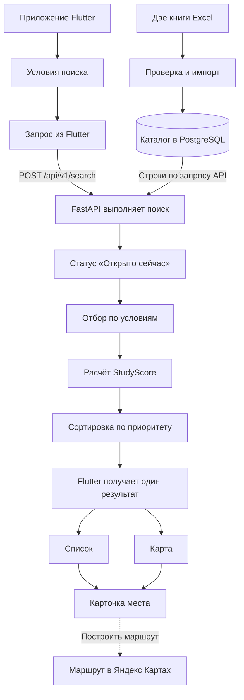
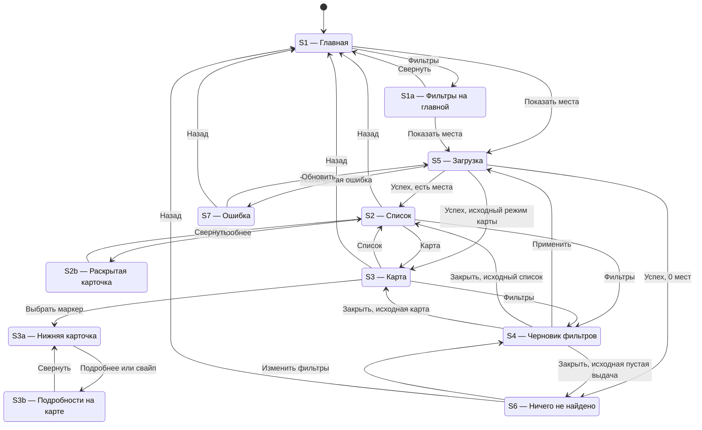
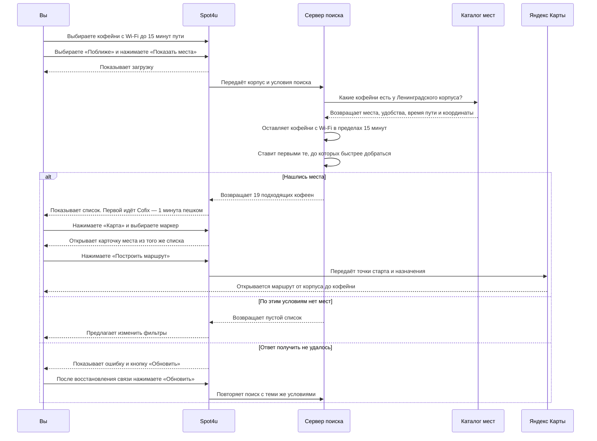
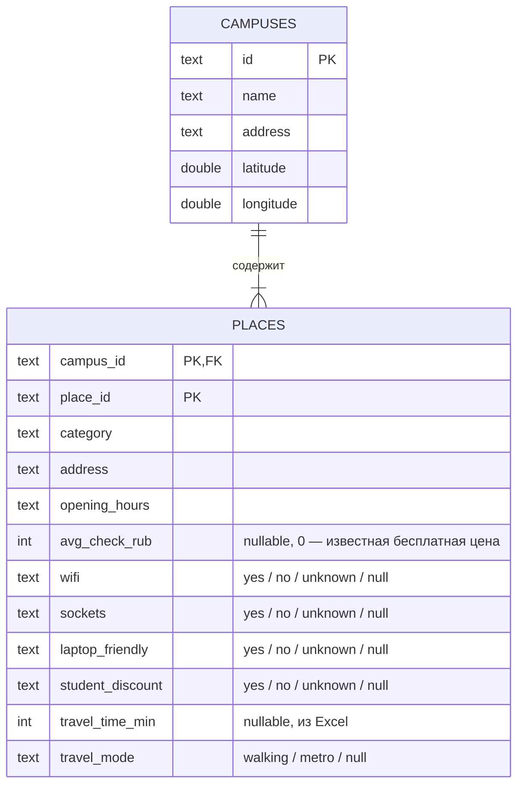

# Архитектура Spot4u

[Полная диаграмма Mermaid](Spot4u.mmd) объединяет запуск, импорт, клиент, API, хранение, поиск и внешние сервисы. [Открыть схему с масштабированием](Spot4u.html#full-solution).

## Модули и поток данных

Клиенты не обращаются к PostgreSQL напрямую и не вычисляют StudyScore самостоятельно. Исходные книги Excel лежат в `Data/`. Время и способ прибытия берутся из них без пересчёта.

## Состояния пользовательского сценария

## Последовательность поиска

Представьте, что вы у корпуса на Ленинградском проспекте. До следующей пары есть немного времени. Вы хотите найти кофейню с Wi-Fi, до которой можно добраться за 15 минут.

1. **Вы задаёте условия.** На главном экране выберите «Кофейни». В фильтрах включите Wi-Fi и поставьте «Время в пути» до 15 минут. Выберите «Поближе» и нажмите «Показать места».
2. **Приложение передаёт ваш выбор.** На экране появляется индикатор загрузки. В это время приложение отправляет на сервер название выбранного корпуса и условия поиска.
3. **Сервер отбирает кофейни.** Он берёт кофейни из каталога Ленинградского корпуса. Кофейня с подтверждённым Wi-Fi и дорогой в 12 минут подходит. Кофейня в 18 минутах или с неизвестным Wi-Fi в список не попадёт.
4. **Ближайшие места появляются первыми.** Вы выбрали «Поближе», поэтому сервер расставляет места по времени в пути и возвращает готовый список. При проверке нашлось 19 кофеен. Первой была Cofix — 1 минута пешком от корпуса, второй — «Шоколадница» — 3 минуты пешком. Время взято из каталога.
5. **Вы смотрите, где находится кофейня.** Нажмите «Карта». Те же 19 мест появятся на карте. Приложение уже получило их координаты, поэтому искать кофейни заново не потребуется. Нажмите на маркер, чтобы открыть карточку.
6. **Вы открываете маршрут.** В карточке нажмите «Построить маршрут». Откроются Яндекс Карты. Началом маршрута будет выбранный корпус, а пунктом назначения — кофейня.

**Что делать, если список не появился**

- **Ничего не найдено.** Поиск завершился, но ни одно место не подошло под все условия. Нажмите «Изменить фильтры», увеличьте время в пути и снова нажмите «Показать места».
- **Не удалось получить ответ.** Так бывает, например, если во время поиска пропала связь. Когда связь вернётся, нажмите «Обновить». Приложение повторит поиск с теми же условиями.

## Модель данных

## Запуск и проверка

- Backend: `docker compose up --build -d`.
- Unit: `python -m pytest -q` и `cd mobile && flutter test`.
- Web: `python3 scripts/build_web.py`, затем `python3 scripts/serve_preview.py`.
- Web E2E: `SPOT4U_PREVIEW_URL=http://127.0.0.1:3000 node scripts/web_e2e.mjs`.
